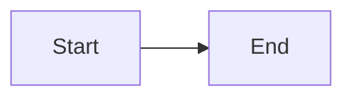
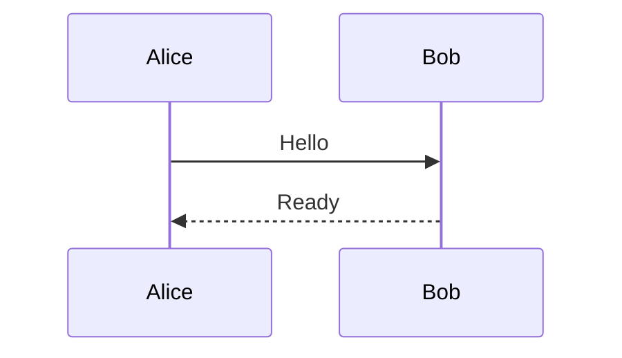
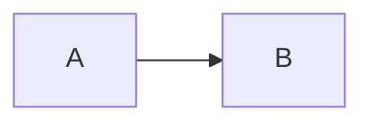

# Reading acceptance
Before diagrams. [Reference][target] and encoded footnote[^a%20b].

```json
{"highlight": true}
```



Between diagrams.



```mermaid
flowchart broken
```



After diagrams.

## Duplicate
First duplicate target.

## Duplicate
Second duplicate target.

[target]: linked.md
[^a%20b]: Encoded footnote body.
